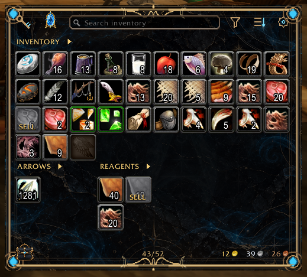
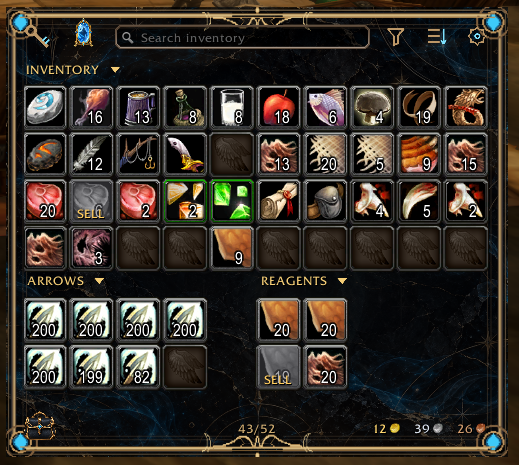
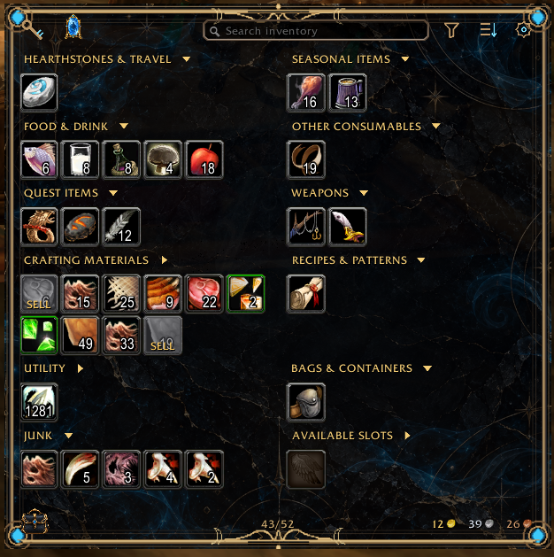
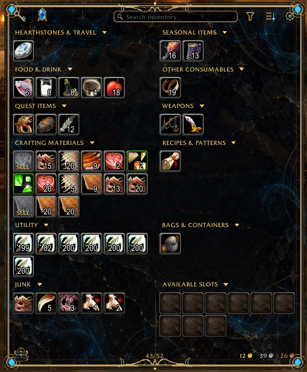
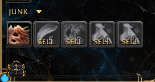
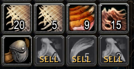
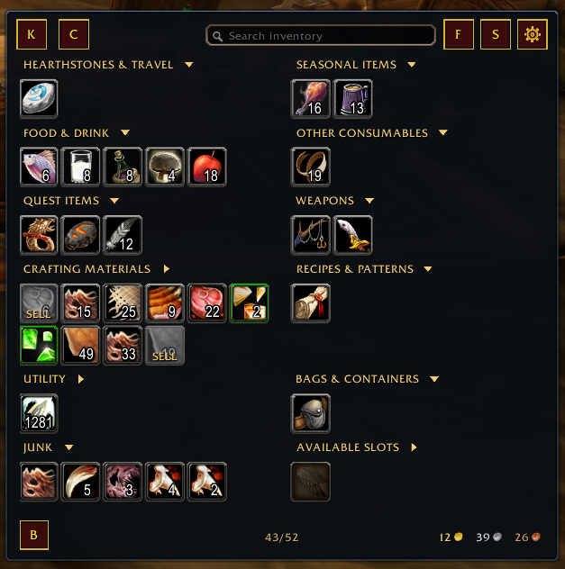

# Obsidian Bags

**Designed with your play style in mind.**

Obsidian Bags is a customizable inventory addon for **World of Warcraft Forever**. Its guiding idea is simple: **your inventory should adapt to you, not the other way around.**

From a compact, unified bag to an extensively organized category view, Obsidian Bags aims to let you choose how much you see, where it appears, and how it looks, without turning setup into a project of its own.

## Features

### Your inventory, your rules

- Choose a unified inventory or a category-based layout.
- Expand and collapse inventory sections to show only what you need.
- Create custom categories with drag-and-drop item placement or comma-separated item IDs.
- Arrange categories and layout elements to suit your preferences.

#### Standard View: everything in one place

A unified inventory keeps items together for familiar, straightforward access, while dedicated inventory sections can be collapsed or expanded when you need more detail.

<p align="center">
  
</p>

<details>
<summary><strong>See Standard View with sections expanded</strong></summary>

<p align="center">
  
</p>

</details>

#### Category View: organization on your terms

Group items into named categories, arrange those categories across columns, and collapse individual sections to control how much of your inventory is visible.

<p align="center">
  
</p>

<details>
<summary><strong>See Category View with sections expanded</strong></summary>

<p align="center">
  
</p>

</details>

### Optimized sorting

Obsidian Bags separates the *virtual arrangement* of items from their *physical storage*. Its sorting engine is designed to do useful work without rearranging items unnecessarily:

- Consolidate partial stacks.
- Place supported items into appropriate specialized bags.
- Avoid physical movements that are not needed for storage optimization.
- Spread sorting operations across multiple frames to reduce interruptions.

Use the **Sort** control whenever you like, or turn on **sort when opening your bags** in settings. Sorting on bag open is **off by default**.

### Effortless junk management

**Mark it. Forget it. Get paid.**

**Alt-click** an unwanted item to mark it as junk. When you visit a vendor, Obsidian Bags automatically sells the items you've marked.

**Junk category and SELL indicators**

<p align="center">
  
  &nbsp;&nbsp;
  
</p>

### Two distinct themes

- **Fancy (default):** Obsidian Arcanum's signature ornate design, with gold detailing, glowing arcane accents, and custom illustrated controls.
- **Basic:** A minimalist, borderless presentation with straightforward controls and adjustable background opacity.

Both themes provide access to the same core inventory features. Here is the category layout in both styles:

| Fancy theme | Basic theme |
| :---: | :---: |
|  |  |

### Required dependency: Syndicator

**[Syndicator](https://www.curseforge.com/wow/addons/syndicator) is required to use Obsidian Bags.** Install and enable its **WoW Forever-compatible** version alongside Obsidian Bags.

Obsidian Bags uses Syndicator's inventory and item data for features including:

- Remembering bags and banks belonging to your other characters.
- Viewing that remembered inventory information remotely.
- Item data and certain category-management features.

Syndicator provides essential services for the complete Obsidian Bags experience. Obsidian Bags is distributed as a separate addon and does **not** bundle Syndicator.

## Compatibility

**Officially supported: World of Warcraft Forever.** **Syndicator is required.**

Retail, Classic, and Classic Era have not been tested and are not currently supported. Support for other game versions may be evaluated in the future.

## Installation

### Option 1: CurseForge (recommended)

1. Open the **[Obsidian Bags project page](https://www.curseforge.com/wow/addons/obsidian-bags)** on CurseForge. *A downloadable release will be available once the first build is published.*
2. Select the release for **World of Warcraft Forever** and install it through the CurseForge app, if your Forever installation is supported.
3. **Syndicator is required.** The CurseForge app should offer/install it automatically when the Obsidian Bags project is configured with [Syndicator](https://www.curseforge.com/wow/addons/syndicator) as a **Required Dependency**. Confirm both addons are installed and enabled, and choose Forever-compatible versions.
4. Launch World of Warcraft Forever or reload the UI.

*If installing a downloaded ZIP manually rather than through the CurseForge app, follow the manual instructions below for **both** addons.*

### Option 2: Manual installation

1. Download the latest **Obsidian Bags release ZIP** from CurseForge or GitHub Releases once published.
2. Download a **World of Warcraft Forever-compatible [Syndicator](https://www.curseforge.com/wow/addons/syndicator)** release. Syndicator is **required**, even for manual installations.
3. Locate your **World of Warcraft Forever** installation's `Interface/AddOns/` directory.
4. Extract the **ObsidianBags** addon folder from its ZIP directly into `AddOns/`. Do not create an extra nested `ObsidianBags` folder.
5. Extract the **Syndicator** addon folder from its ZIP into the **same** `AddOns/` directory.
6. Confirm both addons are enabled, then launch the game or enter `/reload` in chat.

Your installed folders should resemble:

```text
Interface/
└── AddOns/
    ├── ObsidianBags/
    │   ├── ObsidianBags.toc
    │   └── ...
    └── Syndicator/
        ├── Syndicator.toc
        └── ...
```

*The example above reflects the intended public release folder names. Verify the final ZIP structure before publication.*

## Configuration and settings

Open settings by clicking the **cog in the upper-right corner** of the Obsidian Bags inventory window, or use either slash command:

- `/obags`
- `/obsidianbags`

From the settings interface, customize your layout, categories, themes, and sorting preferences.

## Support and feedback

For bugs, feature requests, and feedback, please use **[GitHub Issues](https://github.com/Obsidian-Arcanum/ObsidianBags/issues)**.

For bug reports, please include your addon version, what happened, what you expected, and steps to reproduce the issue if possible.

## Development and credits

Obsidian Bags is developed by **[Obsidian Arcanum](https://github.com/Obsidian-Arcanum)**.

- [Project source repository](https://github.com/Obsidian-Arcanum/ObsidianBags)
- [Syndicator](https://www.curseforge.com/wow/addons/syndicator) by **plusmouse**, an independent addon providing inventory and item data required by Obsidian Bags. Install it separately (or through the CurseForge dependency feature).

Obsidian Bags is currently in active development. Public release links and screenshots will be updated as the first release is finalized.
